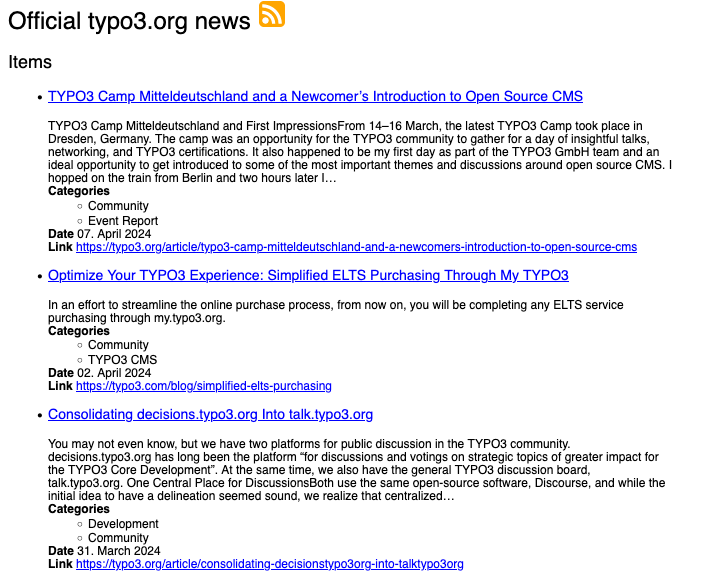
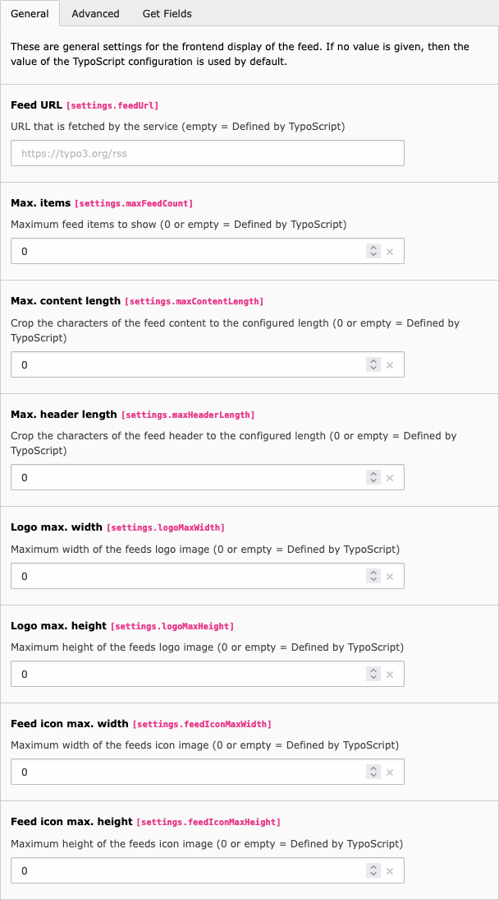

# Feed Display

[](https://github.com/ErHaWeb/feed_display/actions/workflows/ci.yml)
[](https://packagist.org/packages/erhaweb/feed-display)
[](LICENSE)
[](https://docs.typo3.org/p/erhaweb/feed-display/main/en-us/Compatibility/)

Feed Display fetches RSS and Atom web feeds and renders selected feed data in
TYPO3 frontend content elements. It uses the
[SimplePie](https://simplepie.org/) feed parser and exposes feed and item data
to Fluid templates.

Remote `http` and `https` feeds are fetched through TYPO3's PSR-17/PSR-18 HTTP
client, so instance-wide HTTP settings such as proxy configuration are applied
automatically. Parsed results are cached through TYPO3's caching framework and
refreshed when plugin configuration changes or the configured cache lifetime
expires.

## At a glance

| Item | Value |
|------|-------|
| Extension key | `feed_display` |
| Composer package | [`erhaweb/feed-display`](https://packagist.org/packages/erhaweb/feed-display) |
| TYPO3 support | <code>^13.4 &#124;&#124; ^14.3</code> |
| PHP support | `>=8.2 <8.6` |
| Documentation | [docs.typo3.org](https://docs.typo3.org/p/erhaweb/feed-display/main/en-us/) |
| TER | [extensions.typo3.org](https://extensions.typo3.org/extension/feed_display) |
| Source | [GitHub](https://github.com/ErHaWeb/feed_display) |
| Issues | [GitHub Issues](https://github.com/ErHaWeb/feed_display/issues) |

## Highlights

- RSS and Atom frontend rendering powered by SimplePie.
- TYPO3 HTTP client integration for remote feeds.
- Configurable feed and item fields for Fluid templates.
- Site Set support for TYPO3 v13 and v14, with a static TypoScript fallback.
- Content-element FlexForm settings plus Site Settings and TypoScript constants.
- Dedicated cache for parsed feed data and plugin configuration.

## Installation

```bash
composer require erhaweb/feed-display
```

Continue with the
[Composer installation guide](https://docs.typo3.org/p/erhaweb/feed-display/main/en-us/Installation/)
and the
[Quick start](https://docs.typo3.org/p/erhaweb/feed-display/main/en-us/QuickStart/).

Classic installations should use the complete TER package, which includes a
locked SimplePie runtime bundle. Git checkouts and GitHub source archives do
not contain that generated bundle. Before activating a Classic Git checkout,
build it from the extension directory:

```bash
composer build-extension
```

No Composer invocation is needed on a Classic production server when installing
the TER package. Composer installations use the project's regular SimplePie
dependency instead of the bundled copy.

For development, `Build/Scripts/runTests.sh -s libraries` builds the same bundle;
`-s verifyLibraries` checks it and `-s artefact` builds and verifies a TER ZIP.
See [.github/RELEASE.md](.github/RELEASE.md) for library updates and releases.

### Container execution

By default the runner uses the first reachable container service, preferring
Docker over Podman. Merely installing a Podman CLI does not select an inactive
Podman VM. Use `-b docker` or `-b podman` to select a backend explicitly, or set
`FEED_DISPLAY_TEST_BACKEND=docker` as a shell default. An explicit `-b` wins.
An unreachable backend fails before creating build directories and reports the
original connection error.

`Build/Scripts/runTests.sh -s libraries` runs PHP and Composer inside the selected
PHP container; no host PHP/Composer installation is required. A dedicated
container network is created only for functional tests with a separate database
container. Library builds and SQLite tests use normal container networking.
`-b host` remains an explicit opt-in to local PHP/Composer execution.

`Build/Scripts/runTests.sh -s testBackend -b host` verifies these selection and
networking rules with disposable mock engines, without starting containers.

### Cleaning generated files

`Build/Scripts/runTests.sh -s cleanBuild` removes `.Build` (test dependencies,
Classic instances, downloaded Core archives, coverage and bundled test tools)
and temporary root Composer files. Other caches and generated output remain.

`Build/Scripts/runTests.sh -s clean` additionally removes caches, local test
configuration/runtime, TER ZIPs, generated documentation/browser reports,
temporary tool lockfiles and the generated SimplePie runtime bundle. The
versioned `Build/SimplePie/composer.lock` and source files are preserved.
Empty generated parent directories are removed; Playwright sources and baselines
keep their directory intact.
An active Classic Git checkout needs `composer build-extension` afterwards.
These file-cleanup commands do not require Docker, regardless of `-b`.

`Build/Scripts/runTests.sh -s testCleanup -b host` verifies both cleanup scopes
in a disposable fixture without installing dependencies or touching this checkout.

## Preview





## Documentation and support

- [Official documentation](https://docs.typo3.org/p/erhaweb/feed-display/main/en-us/)
- [TYPO3 Extension Repository](https://extensions.typo3.org/extension/feed_display)
- [GitHub issues](https://github.com/ErHaWeb/feed_display/issues)
- [Source code](https://github.com/ErHaWeb/feed_display)
